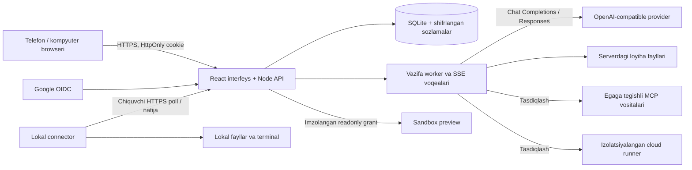

# OpenSI 0.3.0 arxitekturasi

## Bajarilish shartnomasi

`queued → running → completed / failed / cancelled / interrupted`.
Agent savoli `waiting_input`, terminal/MCP `waiting_approval` holatini yaratadi.
Tasdiq egasi va vazifa holati tekshiriladi. Rad etilgan amal vosita natijasiga
yoziladi; uni bajarildi deb belgilash uchun yolg‘on natija yaratilmaydi.
Bekor qilish provider oqimini va faol connector buyrug‘ini to‘xtatadi.

Har bir model chaqiruvining input/output sarfi provider qaytargan `usage`dan olinadi.
Usage yo‘q chaqiruvlar alohida sanaladi. Delegatsiya qilingan agent chaqiruvlari
ham shu vazifa/foydalanuvchi hisobiga yoziladi. Ma’lum sarf bo‘yicha oylik limit
chaqiruvdan oldin tekshiriladi; provider usage bermasa qat’iy token cap kafolatlanmaydi.

Holat va SSE voqealari bazada saqlanadi. Browser qayta ulanishda voqea cursoridan
keyingi tarixni o‘qiydi. Worker bitta Node jarayonida; ishlab turgan vazifani boshqa
serverga uzluksiz migratsiya qilish yoki crashdan aynan keyingi token bilan davom
ettirish bu versiyada yo‘q. Server restartida faol vazifalar `interrupted`ga o‘tadi.

`live_runs` joriy model bosqichi, ochiq javob, yozilayotgan fayl qoralamalari va
terminal chiqishini saqlaydi. Qisman `write_file` JSON faqat ko‘rsatish uchun
dekodlanadi; vosita to‘liq va valid argument kelgandan keyin bajariladi. `live`
metadata, `file_delta` va `terminal_delta` bo‘laklari SSE orqali uzatiladi. UI
hodisa IDlarini takror qo‘llamaydi va 10 soniyalik snapshot bilan uzilgan oqimni
tiklaydi. Snapshot javobiga katta oqim tarixini qayta yuklash o‘rniga joriy qoralama
kiradi. Modelning ichki reasoning matni interfeys yoki hodisa bazasiga yozilmaydi.

Model so‘rovi uchun umumiy limit 30 daqiqa, ma’lumotsiz oqim uchun 4 daqiqa.
Agent bir vazifada 64 bosqichgacha ishlaydi; oylik token limiti har chaqiruvdan
oldin tekshiriladi. Model kontekstida eski o‘qilgan kod qismlari va saqlangan
fayl chaqiruvlari ixchamlanadi; asl suhbat va fayllar bazada saqlanadi.
`response.completed` yoki Chat Completions `[DONE]` belgisidan keyin HTTP ulanishi
ochiq qolsa ham javob yakunlanadi. Fayl saqlanganda preview yangilanadi; oddiy
holat snapshoti previewni qayta yuklamaydi. Qo‘lda saqlash agent tugagach mavjud.

Katta fayllar `write_file` bilan yaratiladi va `append_file` orqali qismlab
to‘ldiriladi; 500 KB fayl chegarasi amal qiladi. Agentga qismlarni taxminan
8000 belgidan saqlash tavsiya qilinadi, lekin model kattaroq kod qaytarsa
to‘liq yozuv ham qabul qilinadi. `edit_file` bir marta uchraydigan
parchani almashtiradi; `copy_file` workspace ichida nusxa yaratadi. Model uchun
`read_file` offset/limit bilan qismlab o‘qiydi; UI to‘liq faylni oladi. Uzilgan
qoralama egasi `/runs/:id/drafts/recover` orqali alohida `drafts/` fayliga
tiklashi mumkin. Tiklash idempotent va oldingi faylga tegmaydi. Davom ettirish
yangi vazifa hisoblanadi, avvalgi xato holati tarixda saqlanadi.

## API yuzasi

| Guruh | Asosiy endpointlar |
| --- | --- |
| Hisob | `GET /api/me`, `/auth/config`, `/auth/google`, `/auth/google/callback`; `POST /auth/logout` |
| Provider | `GET/POST /api/providers`; `PUT/PATCH /providers/:id`; `POST /providers/:id/test` |
| Agent | `GET/POST /api/agents`; `PUT /agents/:id` |
| Vazifa | `GET/POST /api/runs`; `GET /runs/:id`, `/runs/:id/events`; `POST /runs/:id/cancel` |
| Ruxsat | `POST /api/approvals/:id` |
| Fayl | `GET /api/projects`, `/projects/:id/files`, `/projects/:id/file`, `/projects/:id/preview`; `PUT /projects/:id/file` |
| Biriktirish | `POST /api/attachments` |
| MCP | `GET/POST /api/mcp`; `PATCH /mcp/:id` |
| Lokal | `GET /api/nodes`; `POST /nodes/pair-code`, `/nodes/:id/revoke` |
| Connector | `POST /api/connector/pair`, `/poll`, `/heartbeat`, `/progress`, `/result` |
| Admin | `GET /api/admin/overview`; `PATCH /admin/users/:id`; Google settings routes |

Browser mutatsiyalari uchun `x-opensi-client: web` va shu origin sessiyasi kerak.
Connector faqat pairing yoki node bearer tokeni bilan ishlaydi.
Provider hamma foydalanuvchilar ishlatadigan platforma API’si sifatida admin tomonidan
ulanadi; kalit foydalanuvchiga qaytarilmaydi. MCP ulanishi esa ulagan egaga tegishli.

## Chegaralar

- Foydalanuvchi loyihalari va vazifalarini serverda har so‘rovda tekshirish.
- API/MCP sozlamalarini AES-256-GCM bilan shifrlash; node/session tokenlarini hash.
- Provider/MCP URLlari uchun HTTPS, xususiy IP bloklash va ulanish vaqtida DNS
  natijasini tekshirish; redirectni kuzatib maxfiy kalitni boshqa hostga yubormaslik.
- Fayllarda traversal, symlink, yashirin yo‘l, Windows reserved nomlarini bloklash.
- Imzolangan preview URL 15 daqiqalik, readonly. HTTP CSP sandbox va iframe sandbox
  `allow-scripts`; same-origin huquqi va fetch/WebSocket so‘rovlari yo‘q.
  Preview HTTPS rasm va shriftlarni yuklashi mumkin; referrer yuborilmaydi.
- Lokal terminal OS huquqlari bilan ishlaydi. Fayl vositalari yo‘l tekshiruviga
  qaramay, tasdiqlangan terminalni OS sandbox deb hisoblash mumkin emas.
- Cloud terminal ichki broker orqali cheklangan Docker konteynerida ishlaydi.
  Chromium loyiha statik previewini tekshiradi. Internet/paket egress, doimiy backend preview va universal computer-use bu versiyada yo‘q.

## Manbalar

[Google OIDC](https://developers.google.com/identity/openid-connect/openid-connect),
[MCP TypeScript SDK](https://github.com/modelcontextprotocol/typescript-sdk),
[Node SQLite](https://nodejs.org/api/sqlite.html),
[OpenAI function calling](https://developers.openai.com/api/docs/guides/function-calling),
[Codex remote connections](https://learn.chatgpt.com/docs/remote-connections).

OpenSI o‘z server/connector protokolini ishlatadi. OpenAI yoki v0 xizmatiga tegishli
ichki infratuzilma yoki ularning proprietary agent runtime’i ko‘chirilmagan.
